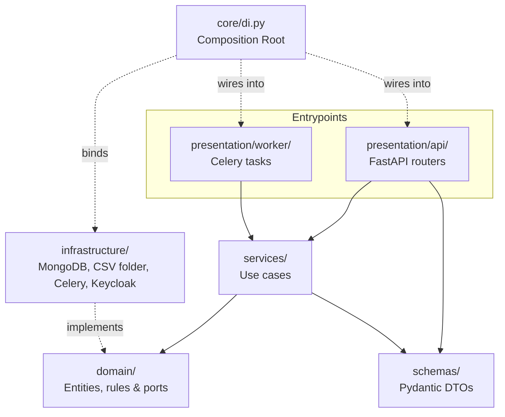
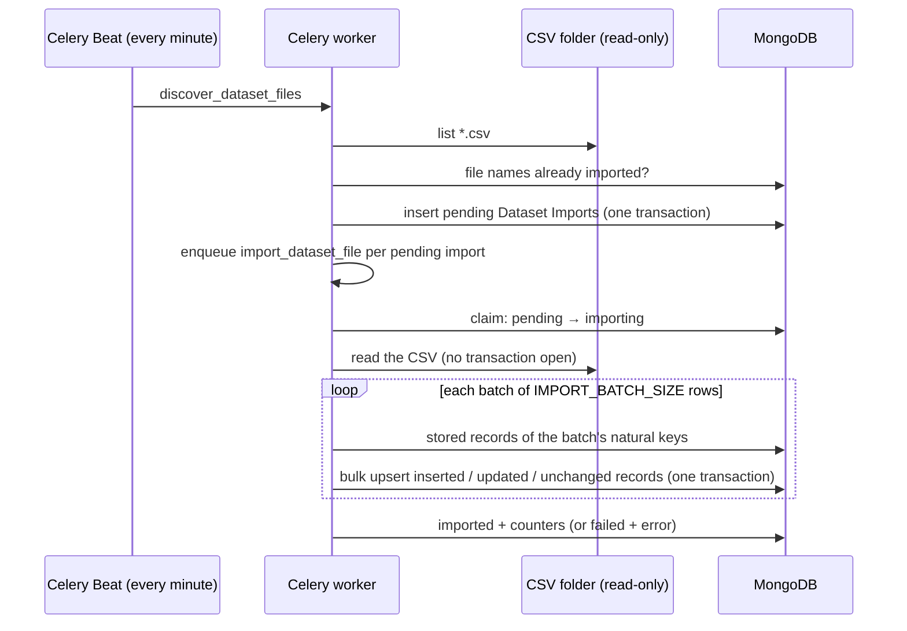

# Architecture

This document describes how Data Reaper is put together: its services, code layout, layers, and background job pipeline. The enforced rules that keep it that way (layering, SOLID, naming, style) live in [CONTRIBUTING.md](CONTRIBUTING.md). It is built on [Night Crawler](https://github.com/martiadrogue/night-crawler)'s stack and architecture: same services, same layers, same rules.

## Services

| Service | Purpose |
|---------|---------|
| FastAPI | HTTP API |
| Reflex | Web UI: login and sign-up through Keycloak (`importer-ui`), Imports (every CSV's import with its counters, scan and retry for admins), Places, and Events (search, source filter, paging). See [frontend/docs/ARCHITECTURE.md](../frontend/docs/ARCHITECTURE.md) |
| MongoDB | Data persistence (single-node replica set `rs0`, so multi-document transactions work) |
| RabbitMQ | Message broker |
| Celery | Background worker: one import per file, on the `dataset-import` queue |
| Celery Beat | Scheduled discovery of new files, every minute |
| Prometheus, celery-exporter | Metrics (opt-in Compose profile `observability`; see [Observability](#observability)) |
| Loki, Grafana Alloy | Logs: Alloy ships every container's stdout to Loki, and the app's OpenTelemetry traces and metrics on to Tempo and Prometheus (same profile) |
| Tempo | Traces (same profile) |
| Grafana | Dashboards over Prometheus, Loki, and Tempo (same profile) |

The Compose project is `data-reaper`. Its container names and host ports differ from Night Crawler's, so both stacks can run side by side:

| What | Host port |
|---|---|
| FastAPI | 8100 |
| Reflex UI / its state backend | 3100 / 8101 |
| MongoDB | 27018 |
| RabbitMQ / management UI | 5673 / 15673 |
| Grafana / Prometheus | 3130 / 9091 |

The `web`, `celery_worker`, and `celery_beat` containers reach MongoDB (`db:27017`) through the `MONGO_URL`/`MONGO_DATABASE` variables Compose injects (`x-app-env`). There is no Redis: logging in, and limiting login attempts, are Keycloak's.

**Keycloak.** Night Crawler's stack runs Keycloak (realm `night-crawler`, with the `importer-api` and `importer-ui` clients); this stack runs none, so Night Crawler's stack must be up first. `web` and `frontend` join its external Docker network `identity` (besides `default`) and reach Keycloak at `http://keycloak:8080`; the Celery worker and Beat never talk to it, so they don't join. `make up` creates the network if it is missing (`identity-network`), and `make down` leaves it. Compose maps the client secrets from `.env`: `KEYCLOAK_ADMIN_CLIENT_SECRET` from `KC_IMPORTER_API_SECRET` (`x-app-env`), and the frontend's `OIDC_CLIENT_SECRET` from `KC_IMPORTER_UI_SECRET`. Both must match `../night-crawler/.env`.

**The CSV folder.** `web` and `celery_worker` mount `CSV_SOURCE_DIR` (`.env`, default `./var/csv/validated`) **read-only** at `/var/lib/data_reaper/csv` (`dataset_import_dir`). Point it at a Night Crawler checkout's `var/csv/validated` to import its runs as they land.

The Reflex frontend talks to the FastAPI backend through server-side `httpx` calls made from inside its own event handlers, never from the browser, so the backend needs no CORS configuration for it.

## Project Structure

```
backend/
└── src/
    └── data_reaper/
        ├── presentation/             # Inbound adapters
        │   ├── api/                  # FastAPI HTTP adapter
        │   │   ├── auth.py
        │   │   ├── dataset.py        # GET /api/datasets
        │   │   ├── dataset_event.py  # GET /api/events
        │   │   ├── dataset_import.py # /api/dataset-imports (list, get, scan, retry)
        │   │   ├── dataset_place.py  # GET /api/places
        │   │   ├── dependencies.py
        │   │   ├── exception_handler.py
        │   │   ├── root.py
        │   │   └── user.py
        │   └── worker/
        │       └── tasks.py          # Celery task adapter
        ├── core/                     # Cross-cutting & DI wiring
        │   ├── config.py
        │   ├── di.py                 # Composition Root
        │   ├── logging.py
        │   └── telemetry.py          # OpenTelemetry providers and instrumentation
        ├── domain/                   # Framework-free core; layout in DOMAIN_MODEL.md §2.1
        ├── infrastructure/           # Data access & adapters
        │   ├── db/                   # Mongo index/validator definitions, read/write repository sets, one repository per entity
        │   ├── external/             # Keycloak: jwks_token_verifier.py (access tokens), keycloak_user_directory.py (accounts)
        │   ├── storage/              # local_dataset_file_storage.py: lists and reads the CSV folder
        │   ├── tasks/                # celery_import_dispatcher.py
        │   └── telemetry/            # open_telemetry_import_metrics.py
        ├── schemas/                  # DTOs, one file per resource
        ├── services/                 # Use cases: auth, users, dataset imports, import processing, dataset records
        ├── __init__.py
        ├── celery.py
        └── main.py

observability/                    # configs for the `observability` Compose profile
├── prometheus/prometheus.yml     # scrape targets
├── loki/loki-config.yaml         # single-process Loki, 14-day retention
├── tempo/tempo-config.yaml       # single-process Tempo, 14-day retention
├── alloy/config.alloy            # container logs → Loki; app OTLP → Tempo, Prometheus
└── grafana/                      # provisioned data sources and the overview dashboard

frontend/                         # detailed in frontend/docs/ARCHITECTURE.md
└── src/data_reaper/   # api_client.py, forms.py, state/, components/, pages/
```

## Layers

The rules for these layers (what each may import, accept, and return, and where adapters are bound) are in [CONTRIBUTING §1](CONTRIBUTING.md#1-architecture-rules). What each package holds:

- **presentation/**: inbound adapters. `api/` holds the FastAPI routers, dependency stubs, and exception handler; `worker/` holds the Celery task entrypoints.
- **services/**: the use cases.
  - `dataset_import_service`: discovery, listing, and retry.
  - `import_processing_service`: importing one file.
  - `dataset_record_service`: browsing places, events, and datasets.
  - `auth_service`: who calls the API, from a Keycloak access token.
  - `user_service`: admins managing accounts, through the Keycloak user directory.
- **schemas/**: Pydantic request and response models.
- **domain/**: entities, value objects, ports, pure rules (file names, Dataset detection, row normalization, upserts and change detection, tallies), and the `AppException` hierarchy. Its layout is in [DOMAIN_MODEL §2.1](DOMAIN_MODEL.md#21-how-domain-is-organized).
- **infrastructure/**: the adapters behind the ports.
  - MongoDB repositories, grouped into `MongoReadRepositories` and `MongoWriteRepositories`.
  - `LocalDatasetFileStorage` (the CSV folder), `CeleryImportDispatcher`, `JwksTokenVerifier`, `KeycloakUserDirectory`, and `OpenTelemetryImportMetrics`.
- **core/**: settings, logging, telemetry, and the Composition Root (`core/di.py`). It creates the process-wide clients and owns their startup and shutdown. It maps each repository port to its adapter (`REPOSITORY_FACTORIES`).

`GET` routes run on read repositories (no transaction). The other routes run the whole use case in one MongoDB transaction ([CONTRIBUTING §1.5](CONTRIBUTING.md#15-data-access)).



Solid arrows are imports. Dotted arrows show how concrete adapters are plugged in behind the `domain/` abstractions, without `presentation/` or `services/` ever importing them.

## API

| Route | Who | What |
|---|---|---|
| `GET`, `POST /api/users`; `GET`, `PATCH`, `DELETE /api/users/{id}` | admins | Keycloak accounts, by email: create (a `user` with a temporary password), change email, temporary password, or role; `DELETE` disables (204), never deletes ([User Directory](#user-directory)) |
| `GET /api/datasets` | users | Each Dataset's collection, columns, and records per source |
| `GET /api/dataset-imports?status=` | users | Imports, newest first, with counts per status |
| `GET /api/dataset-imports/{id}` | users | One import: counters, field changes (most changed first), rejected rows, error |
| `POST /api/dataset-imports/scan` | admins | Discover new files now (202) |
| `POST /api/dataset-imports/{id}/retry` | admins | Queue a non-`imported` import again (202; 409 if imported) |
| `GET /api/places?text=&source=`, `GET /api/places/{id}` | users | Places by name; `text` matches name or address |
| `GET /api/events?text=&source=`, `GET /api/events/{id}` | users | Events by name |

Listings follow the shared pagination policy (`domain/rules/pagination.py`): a filtered listing is one page of up to 50, and an unfiltered one pages up to 300 deep. Record pages also return `total`.

## Authentication

Keycloak, run by Night Crawler's stack, issues the access tokens; the API only checks them. A protected route declares `get_current_user` (or `require_admin`), which hands the bearer token to `auth_service.get_user_from_token` and its `AbstractTokenVerifier` port. `JwksTokenVerifier` accepts a token only if it is:

- signed RS256 with a key from Keycloak's JWKS (`OIDC_JWKS_URL`, fetched over the `identity` network);
- unexpired, issued by `OIDC_ISSUER`, and meant for `OIDC_AUDIENCE` (`importer-api`) among its `aud`;
- carrying a `sub`, an `email`, and at least one of the realm roles `admin`, `user`, `viewer` (`realm_access.roles`). The highest one wins (`domain/rules/user_roles.py`), and others such as `offline_access` are ignored.

Anything else is a 401 `Invalid or expired session token`; a missing token is a 401 `Not authenticated`; a JWKS that can't be fetched is a 502. The user is read from the token alone, with no database lookup, so a disabled account or a changed role takes effect only when its token expires. The user's `id` is Keycloak's `sub`.

One verifier serves the whole web process (`core/di.py`), so every request shares its key cache. `PyJWKClient` keeps the key set for 5 minutes, fetches it again when a token names an unknown `kid` (Keycloak rotated its keys), and fetches with blocking `urllib`, so lookups run in `asyncio.to_thread`. Tests never reach Keycloak: they sign tokens with a local RSA key and serve its JWKS from a throwaway HTTP server (`backend/tests/conftest.py`).

### User Directory

`/api/users` manages the realm's accounts through `user_service` and the `AbstractUserDirectory` port; nothing about them is stored in MongoDB. `KeycloakUserDirectory` calls Keycloak's Admin REST API (`KEYCLOAK_URL`, `KEYCLOAK_REALM`) as the `importer-api` service account (`KEYCLOAK_ADMIN_CLIENT_ID`), whose secret Compose maps from `KC_IMPORTER_API_SECRET`. Without it every `/api/users` call is a 502. The web process keeps one directory (`core/di.py::create_user_directory`), so its connection pool and admin token are shared.

- **Admin token:** the client-credentials grant, cached until 30 s before it expires and fetched under a lock. The client secret goes only to the token endpoint and is never logged.
- **Roles:** read from the account's effective realm roles (`/role-mappings/realm/composite`), so the `user` every account gets through `default-roles-night-crawler` counts. Setting a role removes that composite and the other API roles, then maps the new one; otherwise a `viewer` would stay outranked by the composite's `user`.
- **Listing:** full representations (brief ones lack `createdTimestamp`), by Keycloak username, which is the email. Accounts imported with the realm have no creation time, so `created_at` may be `null`.
- **Changes:** fetch the whole representation, modify it, and `PUT` it back, so no field is reset. Passwords go through `/reset-password` as temporary ones (the user must change them at login). A 409 from Keycloak is `Email already taken` (400).
- **Disabling** sets `enabled: false`; accounts are never deleted.
- **Last admin:** enabled accounts holding `admin` directly, paged from `/roles/admin/users`. This needs the `view-realm` role the realm file grants the service account.
- Keycloak unreachable, refusing the credentials, or answering any other error is a 502 (`ExternalServiceException`).

The API has no login, registration, or password of its own: the UI logs in through Keycloak ([frontend/docs/ARCHITECTURE.md](../frontend/docs/ARCHITECTURE.md#authentication)), and Keycloak handles sign-up and brute-force protection ([BUSINESS_RULES §8](BUSINESS_RULES.md#8-authentication-and-abuse-protection)).

## Background Job Pipeline

Celery runs one queue, `dataset-import` (`IMPORT_QUEUE`). The Celery app lives in `data_reaper/celery.py`. The dev `celery_worker` runs with `--concurrency 1` (`docker-compose.override.yml`), so imports run one at a time in queue order, oldest run first, and two files never race to insert the same new record.



1. **Discovery** (`data_reaper.tasks.discover_dataset_files`, every minute; or `POST /api/dataset-imports/scan`). `dataset_import_service.discover_files` lists the folder and diffs it against `dataset_imports.file_name`. It creates a `pending` import per new file, oldest run first, commits, then enqueues each. A file whose name doesn't parse is stored `failed` and never enqueued.
2. **Import** (`data_reaper.tasks.import_dataset_file`). The task opens `core/di.py::open_import_infrastructure` (its own MongoDB client, the file storage, the metrics, the batch size) and hands it to `import_processing_service.process_import`:
   1. claims the import (`pending` → `importing`). Any other status is skipped, so a redelivered task does nothing;
   2. reads the file with no transaction open, and detects its Dataset from the header (`domain/rules/dataset_detection.py`);
   3. per batch, in one write transaction: normalizes each row (`dataset_rows.py`; a bad row is rejected and counted), fetches the stored records of the batch's natural keys, and decides each row's outcome (`record_upserts.py`). It then bulk-upserts the records it touched;
   4. saves `imported` with the counters, the per-field change counts, and the first 20 rejected rows, or `failed` with the error.

Each task opens its own MongoDB client (`core/di.py::open_task_repositories`): Celery runs each task in a fresh event loop, and an async client can't cross loops. Tasks are acknowledged late (`task_acks_late`), so a worker crash hands the message to another worker. The import is then `importing`, and the redelivery skips it; an admin's **Retry** resumes it, and the batches already committed come back `unchanged`.

## Observability

Three signals, all opt-in through the `observability` Compose profile (`make up-observability`): **logs**, **metrics**, and **traces**. Grafana (`:3130`) shows all three and links them: a log line's `trace_id` opens its trace.

**Logs.** The API, the worker, and Beat all log through `core/logging.py`, configured by `logging_config.yaml`. Each line is one JSON object on stdout: `time` (UTC), `level`, `logger`, `message`, and `exception` with the traceback when there is one. While `import_dataset_file` runs, every line carries the import's `import_id` (`core/logging.py::bind_import_id`). `data_reaper.*` loggers log at `DEBUG` when `APP_ENV=development` and `INFO` otherwise.

**Traces and metrics.** `core/telemetry.py::setup_telemetry` sets up OpenTelemetry in each process: the API on import, each Celery worker process after the fork, and Beat. It instruments Celery and PyMongo, and pushes over OTLP/HTTP to Alloy. It is on only when `OTEL_EXPORTER_OTLP_ENDPOINT` is set (`make up-observability` sets `http://alloy:4318`); `make test` always runs with it empty. An import's span carries `data_reaper.import_id`, so Tempo finds it with `{span.data_reaper.import_id="<id>"}`.

| Metric | Labels | Recorded by |
|---|---|---|
| `dataset_imports_total` | `dataset`, `status` | `OpenTelemetryImportMetrics`, through `AbstractImportMetrics`, once per finished import |
| `dataset_import_duration_seconds` (histogram) | `dataset`, `status` | same |
| `dataset_import_rows_total` | `dataset`, `outcome` (`inserted`, `updated`, `unchanged`, `rejected`) | same |
| `http_server_request_duration_seconds` and others | method, route, status | FastAPI's native telemetry |

No label ever holds an import id or a file name: each value would be a new series in Prometheus.

**The `observability` profile** starts the following next to the stack:

- **Prometheus** (`:9091`), which scrapes the API's dev-only `/metrics`, RabbitMQ, and celery-exporter, and receives the app's metrics from Alloy.
- **celery-exporter**, which turns task events into metrics.
- **Grafana Alloy**, which ships the stdout of every container in the `data-reaper` Compose project to Loki, and the app's OTLP to Tempo and Prometheus.
- **Loki** and **Tempo**, which keep 14 days of logs and traces.
- **Grafana**, with the provisioned **Data Reaper overview** dashboard. It shows health stats, imports per dataset and their duration, rows by outcome, one import's logs and trace by `import_id`, queue depth, task outcomes, recent warnings and errors, and API traffic.

The profile is meant for development machines. Alloy's Docker socket mount lets it read every container on the host, and Grafana falls back to `admin` / `admin` when `GRAFANA_ADMIN_PASSWORD` is unset.
