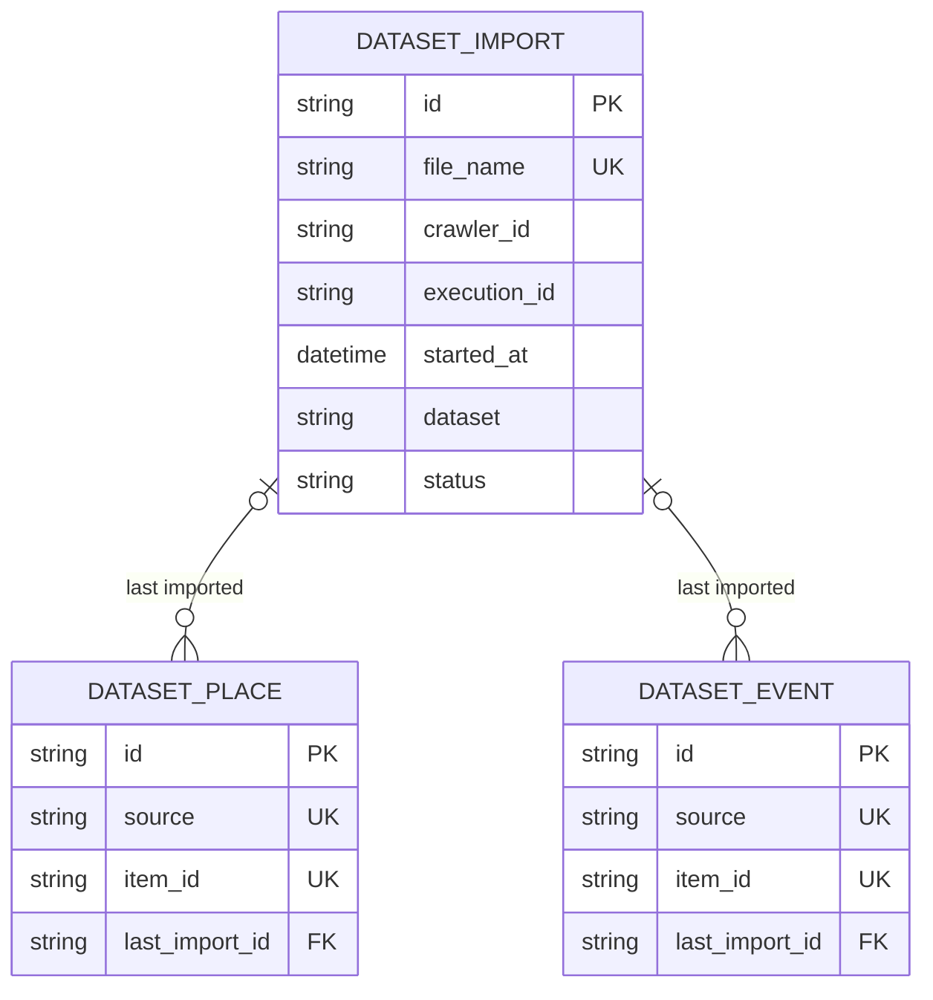

# Domain Model

This document describes Data Reaper's domain: its vocabulary, entities, value objects, relationships, and the structural invariants that always hold. It is extracted from `backend/src/data_reaper/domain/` (entities and rules) and `infrastructure/db/schema.py` (indexes and validators). When the two disagree with this file, the code wins and this file must be updated.

What the system must deliver lives in [BUSINESS_RULES.md](BUSINESS_RULES.md). How the code is layered lives in [ARCHITECTURE.md](ARCHITECTURE.md).

---

## 1. Ubiquitous Language

| Term | Meaning |
|---|---|
| **Validated CSV** | A file [Night Crawler](https://github.com/martiadrogue/night-crawler) wrote for one Crawler Execution whose rows passed its validation, found in its `var/csv/validated/` folder. The importer's only input. It is never changed or moved by the importer. |
| **File name** | `<crawler_id>_<execution_id>_<started>.csv`, with `<started>` the run's start in UTC (`20261005T100800Z`). It says which Crawler and run wrote the file, and when that run started. |
| **Dataset** | The kind of data a file holds, detected from its header: `places` (restaurants, bars, venues) or `events` (shows, sessions). Each has its own collection, `dataset_places` and `dataset_events`. |
| **Column** | One header field of a CSV. Each Dataset has a fixed set of known columns (§5.3); a file holds any subset that includes the required ones. |
| **Dataset Import** | The record of loading one file: its status, the Dataset detected, counters, and the reasons rows were rejected. Exactly one per file name. |
| **Discovery** | Listing the CSV folder and creating a `pending` Dataset Import for every file name never seen before. Celery Beat runs it every minute; an admin can run it at once (**Scan**). |
| **Dataset record** | One Place or Event document. Identified by its **natural key**: its Source + its `item_id`. |
| **Source** | The website a record comes from: the host of its `source_url` without `www.` (`thefork.es`, `maps.google.com`, `atrapalo.com`). Half of the natural key, so the same item crawled by two Crawlers of one website merges, and the same id on two websites never does. |
| **Item id** | The website's own id for the item (`item_id` column): a TheFork restaurant id, a Google place id, an event slug. The other half of the natural key. |
| **Upsert** | How a row is written: inserted if its natural key is unknown, otherwise merged into the stored record. Never a second copy. |
| **Content hash** | A SHA-256 of a record's normalized content fields (§5.5). Equal hash = unchanged record. |
| **Sighting** | A row for a record that already exists. It always moves `last_seen_at`; it moves `updated_at` only when the content hash changes. |
| **Rejected row** | A row that can't be imported: a required value is empty, a value isn't of its column's type or is out of range, or a newer file already updated its record. Counted and kept with its reason; the rest of the file goes on. |

---

## 2. Aggregates

| Aggregate | Root | Owns | Purpose |
|---|---|---|---|
| **Identity** | `User` | — | Who can act, and with which role (`admin`, `user`, `viewer`). Kept in Keycloak, not here (§4.1). |
| **Import** | `DatasetImport` | — | Loading one validated CSV: its state, counters, and rejected rows. |
| **Dataset records** | `DatasetPlace`, `DatasetEvent` | — | The deduplicated data. Written only by imports; never deleted by the importer. |

### 2.1 How `domain/` is organized

Code in `domain/` is grouped by *kind*, not by aggregate:

| Folder | Holds | Ask: is it… |
|---|---|---|
| `model/` | `entities.py`, `value_objects.py` (shared ones), `constants.py` | …a business object with an `id` (entity), an immutable value used across the domain (value object), or fixed vocabulary (constant)? |
| `ports/` | `Abstract…` interfaces, plus the result types they return (`DatasetFile`) | …something that does I/O? The domain only declares it; `infrastructure/` implements it. |
| `rules/` | Pure functions, plus value objects only that rule uses (`NormalizedRow`, `ImportSighting`, `RowOutcome`) | …a decision computed from data, with no I/O, clock, or framework? |
| `bundles/` | Frozen dataclasses a use case passes between its steps | …a parameter or result bundle for `services/` rather than a business concept? |
| `exceptions.py` | The `AppException` hierarchy | …an error a rule or port raises? |

Everything in `domain/` imports only the standard library and other `domain/` modules, and nothing in it is mutated in place.

---

## 3. Entity Relationships

`crawler_id` and `execution_id` (on imports and records) name Night Crawler's Crawler and Crawler Execution. They are kept for tracing a record back to the run that wrote it; this database has no such entities.

### 3.1 Relationship rules

MongoDB has no foreign keys. A reference is a string field holding the target's `_id`.

| From → To | Cardinality | On delete of the target |
|---|---|---|
| Dataset Place / Event → Dataset Import (`last_import_id`) | many → 0..1 | **Not maintained**: imports are never deleted by the importer; the id stays as history. |

Nothing in the API deletes an import or a record. Clearing data is an operator's task (`make restart-db`).

### 3.2 Collections

Each entity is stored in its own collection. The surrogate `id` is stored as the document's `_id`.

| Entity | Collection |
|---|---|
| Dataset Import | `dataset_imports` |
| Dataset Place | `dataset_places` |
| Dataset Event | `dataset_events` |

---

## 4. Entities

All entities stored here use a surrogate `id` (UUIDv4 string); a User, kept in Keycloak, uses Keycloak's. Datetimes are naive UTC unless noted.

### 4.1 User

A User lives in Keycloak (Night Crawler's `night-crawler` realm), not in this database. A request's user comes from its access token: their `id` is Keycloak's `sub` (not a UUIDv4 of ours), and their `role` is the highest of the token's realm roles `admin`, `user`, `viewer` (`domain/rules/user_roles.py`). Any `user_id` stored from now on references that `sub`. Admins manage accounts through `AbstractUserDirectory` (`domain/ports/user_directory.py`), whose `DirectoryUser` is:

| Attribute | Type | Constraints / notes |
|---|---|---|
| `id` | str | Keycloak's user id (the tokens' `sub`). |
| `email` | str | Unique; also the account's Keycloak username. |
| `role` | enum \| null | Highest effective realm role among `admin` · `user` · `viewer`; `null` if it holds none (it then can't call the API). Every account gets `user` through the realm's default-roles composite until an admin sets a role: setting one removes that composite and the other API roles, so the account holds exactly the one set. |
| `is_enabled` | bool | `false` once disabled. Accounts are disabled, never deleted (BUSINESS_RULES §9). |
| `created_at` | datetime \| null | Keycloak's creation time; `null` for accounts imported with the realm, which carry none. |

The last-admin rule (BUSINESS_RULES §9) counts enabled accounts holding `admin` directly.

### 4.2 Dataset Import

| Attribute | Type | Default | Constraints / notes |
|---|---|---|---|
| `file_name` | str | — | Unique (natural key, DM-2). The file's name in the CSV folder. |
| `crawler_id`, `execution_id` | str \| null | `null` | Read from the file name; `null` when it doesn't parse. |
| `started_at` | datetime \| null | `null` | The run's start, read from the file name. Every timestamp the import writes on a record is this one (§5.5). |
| `dataset` | enum \| null | `null` | `places` · `events`, set once the header is read (§5.3). |
| `status` | enum | `pending` | `pending` → `importing` → `imported` · `failed`. |
| `metrics` | embedded | all `0` | `rows_read`, `records_inserted`, `records_updated`, `records_unchanged`, `rows_rejected`; each ≥ 0, and `rows_read` is the sum of the other four. |
| `rejections` | list[embedded] | `[]` | `{row_number, reason}` of the first `MAX_STORED_REJECTIONS` (20) rejected rows; `row_number` counts data rows from 1. Every rejected row is still counted. |
| `field_changes` | map[str, int] | `{}` | Per content field, how many `updated` rows changed it (§5.5). Only fields with a count ≥ 1 appear. Imports made before this counter existed read `{}`. The API returns it as a list, most changed first. |
| `error` | text \| null | `null` | Why the import failed. |
| `created_at`, `updated_at` | datetime | — | |
| `imported_at` | datetime \| null | `null` | Set when `status` becomes `imported`. |

Lifecycle:

- **Discovery** creates it `pending` and enqueues it. A file whose name doesn't parse is created `failed` (`The file name doesn't follow <crawler_id>_<execution_id>_<started>.csv…`) and never enqueued.
- **The worker** claims a `pending` import (`importing`); an import in any other status is skipped, so a redelivered task does nothing.
- It ends `imported`, or `failed` with `error`: an unreadable file, a header no single Dataset fits, a database failure, or an unexpected error (`Unexpected error; see logs.`).
- **Retry** puts any import but an `imported` one back to `pending`, with its counters and `field_changes` reset, and enqueues it again: a `failed` one, a `pending` one whose message was lost, or an `importing` one whose worker died.

### 4.3 Dataset records

Every record carries these key and tracking fields:

| Attribute | Type | Constraints / notes |
|---|---|---|
| `source` | str | The website (§1). Unique with `item_id` (DM-3). |
| `item_id` | str | The website's own id. |
| `name` | str | Required. |
| `source_url` | str | Required. The detail page. Not hashed. |
| `content_hash` | str | SHA-256 of the content fields (§5.5). |
| `created_at` | datetime | Run start of the first file that held it. |
| `updated_at` | datetime | Run start of the last file that **changed** it. |
| `last_seen_at` | datetime | Run start of the newest file that held it, changed or not. |
| `crawler_id`, `last_execution_id`, `last_import_id` | str \| null | Who last saw it. |

#### Dataset Place (`dataset_places`)

| Attribute | Type | Default | From column |
|---|---|---|---|
| `address` | str \| null | `null` | `address` |
| `location` | `{latitude, longitude}` \| null | `null` | `location` (JSON object; latitude ±90, longitude ±180) |
| `categories` | list[str] | `[]` | `categories` (JSON list, or one plain text) |
| `rating` | float \| null | `null` | `rating`, 0–10 as the source shows it: TheFork rates out of 10, Google out of 5 |
| `review_count` | int \| null | `null` | `review_count`, ≥ 0 |
| `price_range` | str \| null | `null` | `price_range`, as shown: `3`, `PRICE_LEVEL_MODERATE` |
| `website`, `phone` | str \| null | `null` | `website`, `phone` |
| `opening_hours` | list[str] | `[]` | `opening_hours` (JSON list, one text per weekday) |

#### Dataset Event (`dataset_events`)

| Attribute | Type | Default | From column |
|---|---|---|---|
| `start_date`, `end_date` | datetime \| null | `null` | `start_date`, `end_date`: **wall-clock time in `timezone`**, not UTC |
| `timezone` | str \| null | `null` | `timezone` (IANA, e.g. `Europe/Madrid`) |
| `is_all_day` | bool \| null | `null` | `all_day` (renamed: booleans start with `is_`, CONTRIBUTING R2.2.1) |
| `venue`, `address` | str \| null | `null` | `venue`, `address` |
| `categories`, `organizers` | list[str] | `[]` | `categories`, `organizers` |
| `cost` | str \| null | `null` | `cost`, as shown: `10€ con reserva, 12€ en taquilla` |
| `price_min`, `price_max` | float \| null | `null` | `price_min`, `price_max`, ≥ 0 |
| `image_url` | str \| null | `null` | `image_url` |

---

## 5. Value Objects & Enumerations

### 5.1 Value objects

Immutable, identity-less (`@dataclass(frozen=True)`).

| Value object | Fields | Used for |
|---|---|---|
| `GeoLocation` | `latitude`, `longitude` | A place's `location`. |
| `ImportMetrics` | `rows_read`, `records_inserted`, `records_updated`, `records_unchanged`, `rows_rejected` | A Dataset Import's counters. |
| `RowRejection` | `row_number`, `reason` | One rejected row. |
| `ImportFileName` | `crawler_id`, `execution_id`, `started_at` | What a file name encodes (`domain/rules/import_file_names.py`). |
| `NormalizedRow` | `source`, `item_id`, `content` (field → typed value, the file's columns only) | One row ready to upsert (`domain/rules/dataset_rows.py`). |
| `ImportSighting` | `import_id`, `crawler_id`, `execution_id`, `started_at` | Who saw a row, and when. |
| `RowOutcome` | `outcome`, `record?`, `reason?`, `changed_fields` | What upserting one row gives (`domain/rules/record_upserts.py`). |
| `RecordQuery` | `text?`, `source?` | A record listing's filters. |
| `DatasetFile` | `columns`, `rows` | A CSV as read (`domain/ports/dataset_file_storage.py`). |

Use-case bundles (`domain/bundles/`): `ImportInfrastructure` (repository factories, file storage, metrics, batch size), `RepositorySetFactories`, `ImportBatch` (one batch of rows with its Dataset and sighting), `ImportTally` (counters, rejections, and field changes so far).

### 5.2 Enumerations & constants

All in `domain/model/constants.py`.

| Name | Values |
|---|---|
| `DATASETS` | `places`, `events` |
| `DATASET_COLLECTIONS` | `places` → `dataset_places`, `events` → `dataset_events` |
| `PLACE_COLUMNS`, `EVENT_COLUMNS` | Each Dataset's known columns (§5.3) |
| `REQUIRED_COLUMNS` | `item_id`, `name`, `source_url` |
| `IMPORT_STATUSES` | `pending` (default), `importing`, `imported`, `failed` |
| `IMPORT_OUTCOMES` | `inserted`, `updated`, `unchanged`, `rejected` |
| `IMPORT_QUEUE` | `dataset-import`: the only Celery queue |
| `MAX_STORED_REJECTIONS` | `20` |

`IMPORT_BATCH_SIZE` (500 rows per transaction) is a setting, not a constant (`core/config.py`).

### 5.3 CSV format and Dataset detection

- **Format:** UTF-8 (a byte-order mark is allowed), RFC 4180, header row. An empty cell is `null`. Lists and objects are JSON-encoded. Text may hold HTML entities (`&#8211;`, `&euro;`); they are unescaped.
- **Detection** (`domain/rules/dataset_detection.py`): the Dataset is the one whose known columns include every header column. The import fails, naming the problem, when the header repeats a column, lacks a required one, has a column no Dataset knows, mixes two Datasets' columns, or fits both (only shared columns: `item_id`, `name`, `address`, `categories`, `source_url`).

| Dataset | Known columns | Shared with the other |
|---|---|---|
| `places` | `item_id`, `name`, `address`, `location`, `categories`, `rating`, `review_count`, `price_range`, `website`, `phone`, `source_url`, `opening_hours` | `item_id`, `name`, `address`, `categories`, `source_url` |
| `events` | `item_id`, `name`, `start_date`, `end_date`, `timezone`, `all_day`, `venue`, `address`, `categories`, `organizers`, `cost`, `price_min`, `price_max`, `image_url`, `source_url` | same |

### 5.4 Row normalization

`domain/rules/dataset_rows.py::normalize_row` and `row_values.py`, pure:

| Check | Effect |
|---|---|
| `item_id`, `name`, or `source_url` empty | Rejected: `<column>: required, but empty.` |
| A value isn't of its type (number, whole number, true/false, ISO date-time, JSON list, `{latitude, longitude}`) | Rejected: `<column>: expected <type>, got '<value>'.` |
| `rating` outside 0–10; `review_count`, `price_min`, `price_max` below 0 | Rejected |
| `source_url` has no host | Rejected |
| An optional cell is empty | `null` (`[]` for lists), never an error |
| A column the file lacks | Left out of `content`: the stored value stays (DM-11) |

Types read text: `"9.8"` is a float, `"45"` an integer (`"45.0"` isn't), `True`/`false`/`1`/`no` booleans. A date-time's offset, if any, is dropped without converting.

### 5.5 Upsert and change detection

`domain/rules/record_upserts.py::apply_row`, given the stored record (or none) and the row:

| Stored record | Row's file | Outcome | What moves |
|---|---|---|---|
| none | any | `inserted` | `created_at` = `updated_at` = `last_seen_at` = the run's start |
| `last_seen_at` later than this file's run | older | `rejected` (`a newer file already updated this record`) | nothing |
| same content hash after merging the row | same or newer | `unchanged` | `last_seen_at`, `crawler_id`, `last_execution_id`, `last_import_id`, and `source_url` |
| different content hash | same or newer | `updated` | the above plus the content, `content_hash`, and `updated_at` |

**Hashed:** every field but the tracking ones and `source_url` (it changes with tracking parameters). Lists are sorted first, so reordered categories are no change.

**Field changes:** an `updated` outcome also names, in `changed_fields`, each hashed field whose value differs between the stored record and the merged one, compared the same way as the hash (lists sorted). A value filled, cleared (an empty cell), or replaced counts; a column the file lacks never does (DM-11). `domain/rules/import_tallies.py::count_changed_fields` adds them to the Dataset Import's `field_changes`: one per `updated` row, so they count rows as `records_updated` does, and a record a file repeats can count more than once.

Rows of one batch sharing a natural key merge in file order. A natural key appears once per Source in the collection, whatever the number of files or Crawlers that held it.

### 5.6 Domain exceptions

| Exception | Default status | Meaning |
|---|---|---|
| `AppException` | — | Base of every controlled error (`message`, `status_code`). |
| `ValidationException` | 400 | Client-caused: bad input, not found (404), conflict (409), forbidden (403), unauthenticated (401), a file that isn't valid CSV or fits no Dataset (422). |
| `InvalidRowException` | 422 | One row can't be imported; the import records it and goes on. |
| `ConfigurationException` | 500 | The wiring is wrong (e.g. a repository port with no adapter, or a write through read repositories). |
| `ExternalServiceException` | 502 | Downstream failure: the database (503), the broker, the CSV folder. |

---

## 6. Structural Invariants

| ID | Invariant | Enforced by |
|---|---|---|
| DM-1 | Every entity's primary key is a surrogate UUIDv4; natural keys are unique indexes. | Schema, [CONTRIBUTING R1.4.5](CONTRIBUTING.md) |
| DM-2 | A file name has at most one Dataset Import, so discovery never imports a file twice. | Unique index on `dataset_imports.file_name` |
| DM-3 | A dataset record exists once per natural key (`source` + `item_id`) in its collection. | Unique index `one_record_per_natural_key` |
| DM-4 | Every enum attribute holds only its listed values (import status, dataset; a User's role through `Literal` schemas). | Collection `$jsonSchema` validators, `Literal` schemas |
| DM-5 | Every dataset column has its BSON type; `rating` 0–10; `review_count`, prices, and every import counter ≥ 0; latitude ±90, longitude ±180. | Collection `$jsonSchema` validators |
| DM-6 | Importing is idempotent: importing a file again leaves every record as it was (all `unchanged`). | `record_upserts.apply_row`: timestamps come from the file, not the clock |
| DM-7 | Importing is order-safe: a row from a run older than its record's `last_seen_at` is rejected, so an older file never overwrites newer data. `created_at` ≤ `updated_at` ≤ `last_seen_at`. | `record_upserts.apply_row` |
| DM-8 | A record's `updated_at` moves only when its `content_hash` changes. | `record_upserts.apply_row` |
| DM-9 | Entities are never mutated in place: repositories' `save()` / `save_all()` return new instances; value objects are frozen. | [CONTRIBUTING R1.4.1–R1.4.2](CONTRIBUTING.md) |
| DM-10 | The importer never writes, moves, or deletes a CSV file. | `AbstractDatasetFileStorage` has no write method; Compose mounts the folder read-only |
| DM-11 | A column a file lacks never clears a stored value; an empty cell does. | `dataset_rows.normalize_row` puts only the file's columns in `content` |
