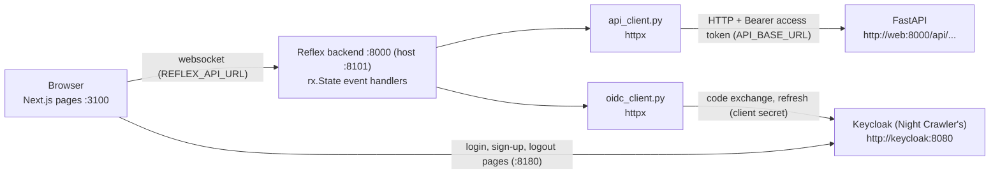

# Frontend Architecture

The frontend is a [Reflex](https://reflex.dev) 0.9 app, like Night Crawler's. Reflex compiles the
Python pages into a Next.js app (port 3000 in the container, 3100 on the
host) and runs a Python backend (port 8000 in the container, 8101 on the
host) that holds each browser tab's state and talks to it over a websocket.

## How It Talks to the API



- Every API call is made by an event handler, server side, through
  `api_client.py`. The browser never calls FastAPI.
- `API_BASE_URL` (Compose: `http://web:8000`) is where the Reflex backend
  finds FastAPI. `REFLEX_API_URL` is where the *browser* finds the Reflex
  backend (dev: `http://localhost:8101`).
- A non-2xx response raises `ApiError(status_code, message)`. The message
  is the API's own `{"message"}`, or FastAPI's validation `detail` joined
  into one line. States show it in a red callout.

## Project Structure

```
frontend/
├── Dockerfile                  # development target; `reflex init` bakes .web/
├── rxconfig.py                 # app name, ports, api_url, theme plugin
├── requirements.txt            # reflex, httpx (+ pytest in requirements-dev.txt)
├── docs/                       # this file and CONTRIBUTING.md
├── tests/                      # forms.py, api_client.py, and oidc_client.py tests
└── src/data_reaper/
    ├── data_reaper.py  # entrypoint: app = rx.App(), `/` redirects
    ├── api_client.py           # one async function per endpoint
    ├── oidc_client.py          # Keycloak: login URL, code exchange, refresh, logout
    ├── forms.py                # pure query/display helpers
    ├── components/
    │   ├── nav.py              # navbar, page_shell, error_callout, status_badge
    │   ├── auth_form.py        # auth_card: the auth pages' centred card
    │   ├── fields.py           # labelled, choice
    │   └── records.py          # records_page: search, source filter, table, paging
    ├── state/
    │   ├── auth_state.py       # AuthState (the Keycloak session), get_session
    │   ├── imports_state.py    # ImportsState
    │   └── records_state.py    # RecordsMixin → PlacesState, EventsState
    └── pages/                  # login, register, auth_callback, imports, places, events
```

## Pages

| Route | State | Shows |
|---|---|---|
| `/login` | `AuthState` | **Log in** and **Create one**, both off to Keycloak. |
| `/register` | `AuthState` | Sends you straight to Keycloak's sign-up page. |
| `/auth/callback` | `AuthState` | Where Keycloak returns: checks the login, then goes to `/imports` (or shows why not). |
| `/imports` | `ImportsState` | A card per Dataset with its record count. Every import, newest first: file, dataset, status, and what its rows did with its three most changed fields, with a status filter and counts per status. Clicking a file opens its detail: crawler, execution, run start, every changed field with its count, error, rejected rows. Admins see **Scan for new files** and a **Retry** button on any import not `imported`. |
| `/places` | `PlacesState` | Places by name: search (name or address), source filter, rating, reviews, price, and a link to the source page. |
| `/events` | `EventsState` | Events by name: search, source filter, start time (wall clock in the event's timezone), venue, categories, cost. |

`/` redirects to `/imports` with a token, else to `/login`.

`PlacesState` and `EventsState` share `RecordsMixin` (a Reflex mixin, so
each gets its own vars). Each says which endpoint it lists, which Dataset
its source options come from, and which list fields become display text.
A search or a new source starts again from the top. A filtered listing is
always one page from the top, as the API rules; the pager is for
unfiltered listings.

## Authentication

Accounts live in Night Crawler's Keycloak (the root
[docs/ARCHITECTURE.md](../../docs/ARCHITECTURE.md#authentication)). The UI
logs in as `importer-ui`, a confidential client, with the Authorization
Code flow and PKCE. Keycloak calls go through `oidc_client.py`, never
`api_client.py`:

1. **Log in** / **Create one** (`AuthState.start_login` / `start_register`)
   builds Keycloak's authorize URL (`oidc_client.create_login_request`:
   a random `state`, a PKCE verifier and its S256 challenge, `prompt=create`
   for sign-up), keeps `state` and the verifier in backend-only vars
   (`_login_state`, `_code_verifier`: never sent to the browser), and
   redirects the browser there (`OIDC_BROWSER_URL`).
2. Keycloak sends it back to `/auth/callback`. `AuthState.finish_login`
   checks the `state` against this tab's (`oidc_client.check_callback`:
   a mismatch, a missing code, or Keycloak's `error` is shown instead),
   then trades the code and verifier for tokens on the token endpoint
   (`oidc_client.exchange_code`, `OIDC_INTERNAL_URL`, with the client
   secret, `OIDC_CLIENT_SECRET`, which Compose maps from
   `KC_IMPORTER_UI_SECRET`).
3. The access token, email, and role go in cookies (`nci_access_token`,
   `nci_email`, `nci_role`, 10 hours: Keycloak's default SSO maximum), so
   new tabs are logged in too. The names start with `nci_` because cookies
   don't separate by port and Night Crawler's UI runs on the same host. The
   email and role are read from the token's claims without checking its
   signature (`oidc_client.read_session_user`): they only decide what the
   UI shows (the admins' **Scan** and **Retry**); the API verifies the
   token. The refresh and id tokens stay in backend-only vars.
4. Access tokens last 5 minutes. Every handler gets the session through
   `get_session(self)` (`state/auth_state.py`) instead of
   `get_state(AuthState)`: when the token is within 30 s of its `exp`
   (`oidc_client.is_expiring`), it is refreshed first
   (`oidc_client.refresh_session`; Keycloak rotates the refresh token).
   `api_client` itself never retries (FR1.2). If the refresh is refused,
   or the tab has no refresh token (a tab opened later, which only has the
   cookie), the session is cleared: the user is logged out, the page's
   `on_load` sends them to `/login`, and logging in again is one click
   while Keycloak's own session lasts.
5. **Log out** clears the session and sends the browser to Keycloak's
   end-session endpoint (`oidc_client.build_logout_url`, with the id token
   as `id_token_hint` when this tab has it, else Keycloak asks to
   confirm), which ends the single sign-on session (Night Crawler's UI
   included) and returns to `/login`.

Every page behind login has an `on_load` handler that redirects to
`/login` when there is no token; `/` sends you to `/imports` or `/login`.
Admin-only buttons are hidden for other roles, but the API still decides:
a non-admin's request gets a 403, shown in the callout.

Settings (Reflex container environment, defaults match Compose):
`OIDC_BROWSER_URL` (`http://localhost:8180/realms/night-crawler`),
`OIDC_INTERNAL_URL` (`http://keycloak:8080/realms/night-crawler`),
`OIDC_CLIENT_ID` (`importer-ui`), `OIDC_CLIENT_SECRET`, and `APP_URL`
(`http://localhost:3100`; the callback is `APP_URL/auth/callback`, and
logout returns to `APP_URL/login`).

## State Conventions

- API data is kept as plain `dict` / `list[dict]`, as the API returns it.
  Anything the page shows in a computed shape is prepared by a pure
  `forms.py` helper first (`with_display_fields`, `import_detail`,
  `with_list_texts`), since Reflex can't index into untyped nested vars.
- After a mutation (scan, retry), the state reloads from the API instead
  of patching its lists.
